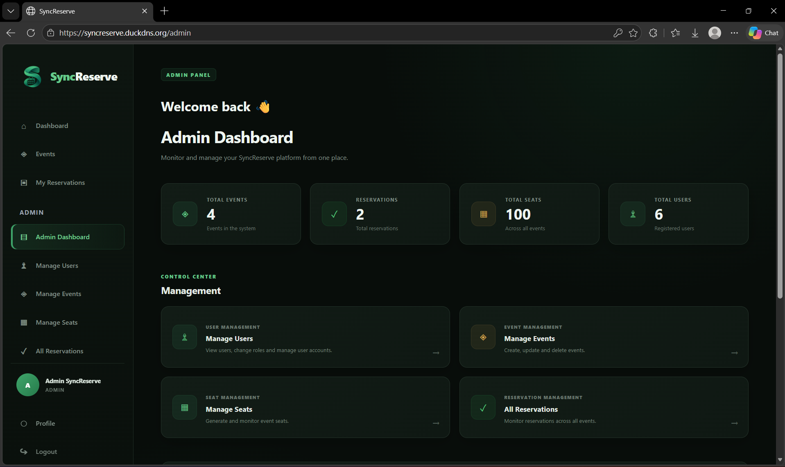
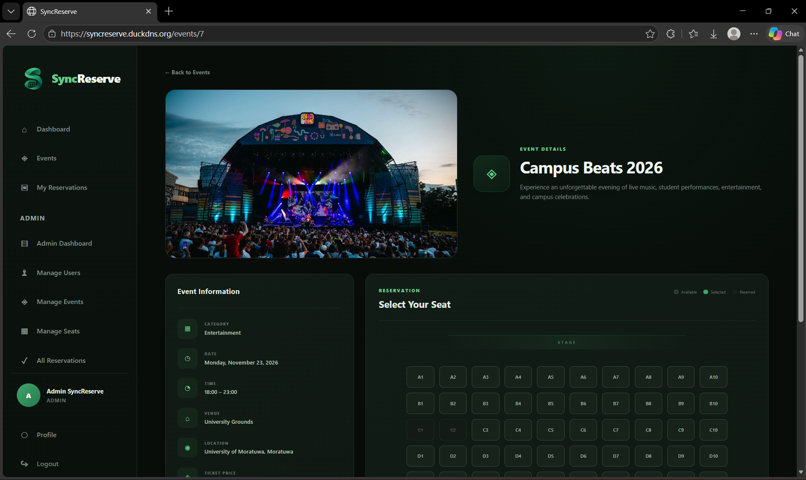

# SyncReserve

### Concurrent Reservation Management Platform

SyncReserve is a full-stack reservation management platform designed to handle concurrent seat reservations while preventing double booking and maintaining database consistency.

The platform demonstrates how database transactions, pessimistic locking, unique constraints, and secure role-based authentication can work together to manage concurrent reservation requests reliably.

---

## Overview

In a traditional reservation system, multiple users may attempt to reserve the same seat simultaneously.

For example, User A and User B might both attempt to reserve seat A10 for the same event at nearly the same time.

Without proper concurrency control, both requests could potentially succeed, resulting in a double booking.

SyncReserve addresses this challenge through backend and database-level concurrency control mechanisms.

By combining pessimistic locking, transactional operations, and database constraints, the system ensures that conflicting reservation requests are handled safely and that a seat cannot be successfully reserved more than once.

## Project Objectives

- Prevent double booking during simultaneous reservation requests.
- Demonstrate practical database concurrency control techniques.
- Maintain data consistency through transactions and database constraints.
- Implement secure authentication and role-based authorization.
- Provide event and seat management capabilities.
- Enable users to create, view, and cancel reservations.
- Provide administrators with centralized management capabilities.
- Build a responsive and user-friendly reservation interface.

## Key Features

### User Features

- User registration and secure login.
- JWT-based authentication.
- User dashboard.
- Browse available events.
- View event details.
- Explore available seats.
- Reserve seats for events.
- View personal reservation history.
- Cancel existing reservations.
- Profile management.

### Administrator Features

Administrators have access to a dedicated administration area with management capabilities.

- Admin dashboard with reservation and system information.
- User management.
- Event management.
- Create, update, and delete events.
- Seat management.
- View and manage reservations.
- Protected administrator routes.
- Role-based access control.

**Separate Dashboard Access**

Administrators can access both the User Dashboard and Admin Dashboard. These are maintained as separate application areas with different responsibilities and access permissions.

## Concurrency Control and Double Booking Prevention

One of the main technical challenges addressed by SyncReserve is handling multiple reservation requests for the same seat.

The system uses multiple layers of concurrency control:

### 1. Database Transactions

Reservation operations are executed within database transactions to maintain consistency and ensure that related database changes are handled atomically.

### 2. Pessimistic Locking

Pessimistic locking is used to control concurrent access to seats during reservation processing.

When one transaction acquires a lock on a seat, conflicting transactions must wait until the lock is released.

### 3. Unique Database Constraints

Database-level unique constraints provide an additional layer of protection against duplicate reservations.

### 4. Safe Conflict Handling

When multiple users attempt to reserve the same seat, conflicting requests are handled safely rather than allowing duplicate bookings.

These mechanisms work together to ensure reliable reservation processing under concurrent access.

## Reservation Workflow

The main reservation workflow follows these steps:

1. An administrator creates an event.
2. The administrator selects the event through Seat Management.
3. Seats are added and managed separately for that event.
4. Users browse available events.
5. Users select an event and an available seat.
6. The backend validates the reservation request.
7. Concurrency control mechanisms protect the reservation operation.
8. The reservation is successfully created or a conflict is returned.
9. Users can view or cancel their reservations.

## Technology Stack

| Layer | Technologies |
|---|---|
| Frontend | React, Vite |
| Backend | Java, Spring Boot |
| Database | PostgreSQL |
| Authentication | JWT |
| Containerization | Docker, Docker Compose |

## System Architecture

SyncReserve follows a layered full-stack architecture.

### Frontend Layer
Provides the user interface for authentication, event browsing, seat selection, reservations, and administration.

### Backend Layer
Handles business logic, authentication, authorization, event management, seat management, and reservation processing.

### Database Layer
PostgreSQL stores application data and enforces relational integrity and database-level constraints.

The backend coordinates transactional operations and concurrency control to maintain reliable reservation processing.

## Security

Security is an important part of SyncReserve.

- JWT-based authentication.
- Role-based authorization.
- Protected administrator endpoints.
- Backend-side access control.
- Database constraints for data integrity.

## Database Entities

The core application data is organized around the following entities:

- **User** – Stores user account and role information.
- **Event** – Stores event information.
- **Seat** – Represents seats associated with events.
- **Reservation** – Stores user reservation records.

These entities work together to support event management and seat reservation operations.

## Getting Started

### Prerequisites

- Java Development Kit (JDK) 21.
- Node.js and npm.
- Docker Desktop.
- Git.

### Clone the Repository

```bash
git clone <YOUR_REPOSITORY_URL>
cd syncreserve
```

### Environment Configuration

Configure the required environment variables for the backend and database before starting the application.

Keep sensitive credentials in local environment files. Never commit passwords, JWT secrets, or other credentials to the repository.

### Run with Docker

```bash
docker compose up -d --build
```

### Access the Application

| Service | URL |
|---|---|
| Frontend | http://localhost:5173 |
| Backend | http://localhost:8080 |

*Note: Configure the required environment variables before running the application.*

## Project Structure

```text
SyncReserve/
├── Backend/
├── Frontend/
├── docker-compose.yml
└── README.md
```

## Future Improvements

Potential areas for future enhancement include:

- Automated concurrent reservation stress testing.
- Improved reservation analytics.
- Enhanced event discovery and filtering.
- Notification support for reservation updates.
- Expanded monitoring and deployment automation.

## Project Focus

SyncReserve focuses on solving a real-world engineering challenge: maintaining data consistency when multiple users compete for the same resource.

By combining transactional database operations, pessimistic locking, unique constraints, and role-based security, the project demonstrates practical approaches to building reliable reservation management systems.

---

**SyncReserve — Reliable Reservations Through Concurrency Control.**

## Application Screenshots

### Home Page


### Admin Dashboard


### User Dashboard


#### Manage Events


### Events


### Event Details


#### Manage Seats


### Seat Selection


