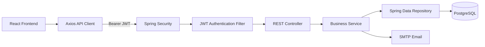

# SyncReserve Architecture

## 1. Project Summary

SyncReserve is a full-stack event seat reservation platform. Its main technical challenge is preventing double booking when multiple users reserve the same seat at nearly the same time.

The application has three main responsibilities:

- Authentication and account recovery
- Event and seat management
- Transaction-safe reservations

## 2. Technology Stack

### Backend

- Java 21
- Spring Boot 4.1.1
- Spring Web MVC
- Spring Data JPA and Hibernate
- Spring Security
- JWT with JJWT
- Jakarta Bean Validation
- PostgreSQL
- Spring Mail
- H2 for automated tests

### Frontend

- React 19
- Vite
- React Router
- Axios
- ESLint
- Lucide React and SweetAlert2 dependencies

## 3. Request Flow

A normal authenticated request works like this:

1. The user logs in through the React application.
2. The backend validates the password with BCrypt.
3. The backend returns a JWT containing the user email, ID, and role.
4. Axios attaches the JWT to later requests.
5. `JwtAuthenticationFilter` validates the token.
6. Spring Security creates an authenticated security context.
7. The controller delegates business logic to a service.
8. The service uses a repository to read or update PostgreSQL.
9. The controller returns a DTO response.

## 4. Backend Package Responsibilities

### `config`

- `SecurityConfig`: stateless security, public routes, role rules, password encoder, error handlers.
- `CorsConfig`: frontend origin and allowed HTTP methods.
- `WebConfig`: serves profile images from `/profile/**`.

### `controller`

Controllers define the HTTP API and apply validation and authorization annotations.

- `AuthController`: register, login, password recovery, password changes, profile images.
- `EventController`: event CRUD and seat generation/viewing.
- `ReservationController`: booking, cancellation, and reservation queries.
- `AdminController`: admin dashboard, user roles, and user deletion.

### `service`

Services contain business rules and transaction boundaries.

- `AuthService`: account lifecycle and reset-code workflow.
- `EventService`: event management and seat layout generation.
- `ReservationService`: booking and cancellation ownership rules.
- `EmailService`: password reset email delivery.

### `repository`

Spring Data JPA interfaces provide database access. `SeatRepository.findByIdWithLock` uses a pessimistic write lock during booking.

### `entity`

The main database entities are:

- `User`
- `Event`
- `Seat`
- `Reservation`

The important relationships are:

- One event has many seats.
- One event has many reservations.
- One user has many reservations.
- One reservation belongs to one user, one event, and one seat.

### `dto`

DTOs define input and output contracts without exposing persistence entities directly. They also hold validation rules for email, password, event, seat, and reservation data.

## 5. Double-Booking Protection

The reservation process uses multiple layers of protection:

1. `@Transactional` keeps the booking operation atomic.
2. The seat is loaded with a pessimistic write lock.
3. The service checks whether the event/seat pair already has a reservation.
4. The database has a unique constraint on `(event_id, seat_id)`.
5. A conflict is converted into a `409 Conflict` response.

The lock protects the concurrent read/check path. The unique database constraint is the final consistency boundary if two requests still reach the insert stage.

## 6. Password Recovery Flow

1. The user submits an email to `/api/auth/forgot-password`.
2. The backend generates a configurable numeric code, normally six digits.
3. The code is hashed before storage.
4. The code expires after 15 minutes.
5. A one-minute resend cooldown is applied.
6. The user submits the code to `/api/auth/verify-reset-code`.
7. Five failed attempts are allowed per code.
8. A successful verification creates a short-lived reset token.
9. `/api/auth/reset-password` accepts the token once and clears it after use.

## 7. Validation Strategy

Frontend validation improves usability, but backend validation is authoritative.

Examples:

- Passwords: 8-100 characters, uppercase, lowercase, and number.
- Event names: maximum 150 characters.
- Event descriptions: maximum 2,000 characters.
- Locations: maximum 200 characters.
- Seat dimensions: 1-100 rows and 1-100 seats per row.
- Event and seat IDs: positive values.
- Event dates: future dates for create and update operations.

## 8. Testing Strategy

The backend uses:

- H2 in-memory database for the Spring context test.
- Mockito unit tests for reset-code behavior.
- Mockito unit tests for reservation ownership and duplicate-seat behavior.

The frontend uses:

- ESLint for static analysis.
- Vite production build for compilation and bundling validation.

## 9. Known Production Improvements

Be ready to describe these as future work:

- Replace localStorage JWT storage with HttpOnly Secure cookies.
- Replace `ddl-auto=update` with Flyway or Liquibase migrations.
- Add IP-based and distributed rate limiting for recovery endpoints.
- Add controller integration tests and frontend end-to-end tests.
- Move CORS origins and profile-image policy to deployment configuration.
